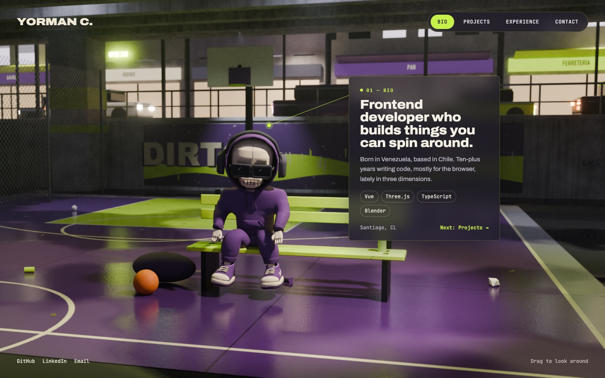
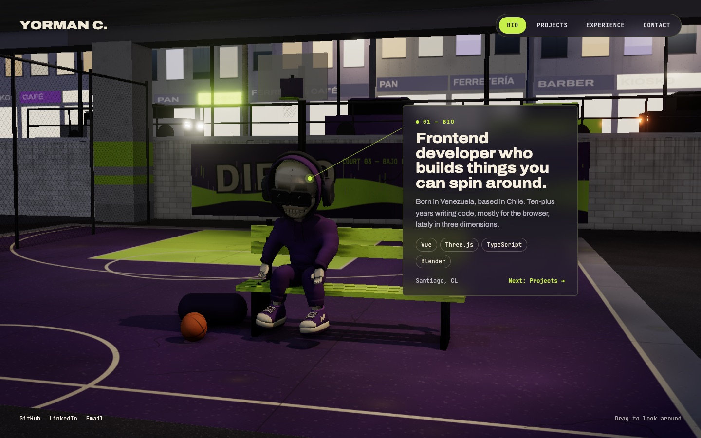

# Dirección de arte v3

Aprobada el 16 de octubre de 2026: **Bajo el puente · Calle · Noche**, dentro de la dirección "Concrete & Acid". El recorrido completo de propuestas (cuatro rondas y la muestra en Blender) está en el artifact de la propuesta de identidad.

| Render en Blender (techo de calidad) | Render en el navegador (Three.js) |
| --- | --- |
|  |  |

Móvil: [web-noche-movil.jpg](direccion-de-arte/web-noche-movil.jpg).

## Escena

- El personaje (el GLB sin cambios) está **sentado en una banca lima** en la banda de una cancha de básquet de barrio, con un balón y un bolso al lado.
- La cancha está **bajo una autopista**. El tablero de hormigón cierra el encuadre por arriba con un borde lima encendido, y los pilares llevan franjas lima y moradas y afiches.
- Al fondo hay un **muro de contención bajo** (2,2 m) con el mural "DIRTO" en morado, lima y hueso. La cancha queda hundida y la calle se ve a la altura del remate del muro.
- **Detrás del muro hay una calle comercial**: vereda con baranda, calzada con cebra y bordes lima, autos (uno morado y uno lima), locales con letreros, semáforo, faroles y edificios con ventanas encendidas al azar.
- **Es de noche.** Hay focos fríos bajo el tablero, un farol cálido sobre la banca que ilumina al personaje, faroles de calle, faros de autos, neón lima y luna. El suelo está mojado, con charcos, y el aire tiene algo de polvo para que la luz tenga volumen.
- Todo está desgastado: pintura desconchada, grietas, juntas, escurridos en el hormigón, papeles, latas y hojas.

Esto reemplaza la decisión anterior de no usar tono nocturno. La noche de la v3 es fría, con acentos lima y morado. No lleva el rojo ni la foto de la v1.

## Paleta

Los colores del modelo, como `purple-*`, `bone` e `ink`, más los propios de la identidad. Todos están en [`src/styles/tokens.css`](../src/styles/tokens.css).

| Rol | Token | Valor |
| --- | --- | --- |
| Acento (botón activo, enlaces, neón) | `--color-lime` | `#C8F04A` |
| Morado de la cancha, mural y pilares | `--color-purple-800` | `#57306F` |
| Líneas de la cancha, letras del mural | `--color-bone` | `#DED2B6` |
| Superficie de la tarjeta | `--color-surface-card` | carbón `#211E2A` al 72 % |
| Texto sobre la tarjeta | `--color-paper` | `#EDE8DC` |

La escena recibe sus colores por configuración (R7). No escribe literales.

## Tipografía

- **Archivo**, en ancho 112–125 % y peso 800–900, para el nombre y los titulares de las tarjetas.
- **Archivo** normal para el cuerpo.
- **JetBrains Mono** en mayúsculas con algo de interletra para la navegación, las etiquetas y los chips.

## Tarjeta flotante

- Cristal carbón al 72 % con desenfoque de 16 px, borde lima tenue y esquinas casi rectas (6 px).
- Una línea lima fina une un punto sobre el modelo con la tarjeta. En móvil la tarjeta va abajo, sobre la barra de secciones, y no lleva línea.
- La navegación es una píldora oscura con la sección activa en lima.

## Para llevarlo al navegador

- **Hornear la luz estática** del entorno en Blender: sombras suaves, rebotes, halos de los faroles y desgaste. Solo el personaje y 1–2 luces quedan dinámicos.
- Los reflejos del suelo mojado se aproximan con un plano reflectante o con SSR, y los conos de luz con geometría falsa.
- Peso objetivo de la escena: 8–15 MB, con una versión ligera que cargue primero.
- Falta una animación `Sit` en el GLB. Las maquetas usan una pose hecha a mano rotando huesos.
- El modelo de prueba `el_dirto_v10.glb` no se commitea.
