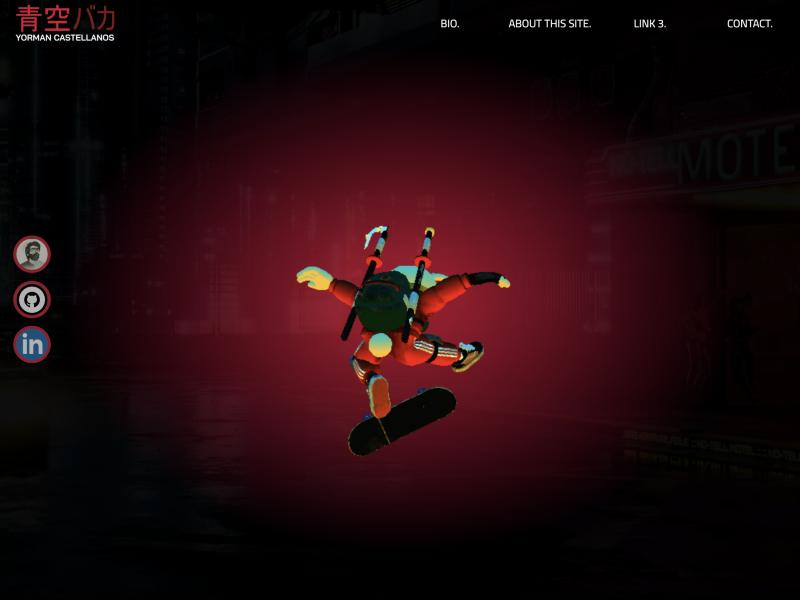
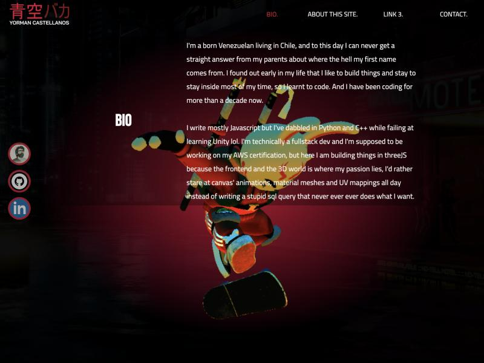
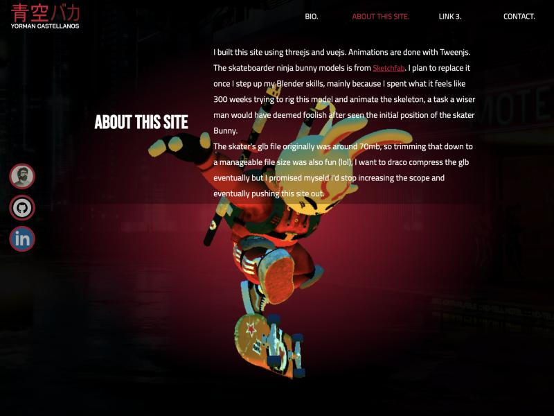
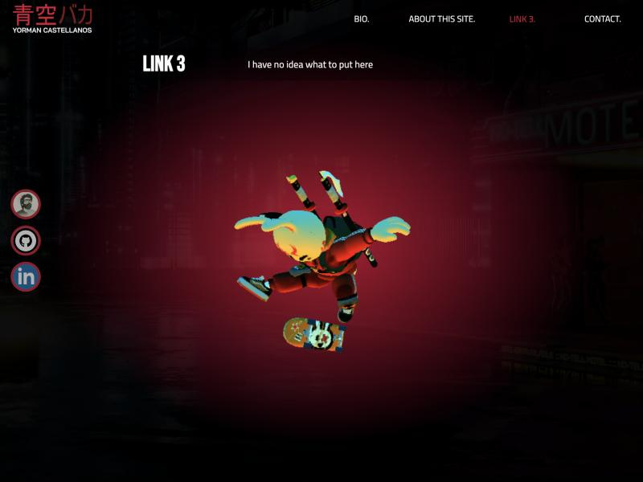
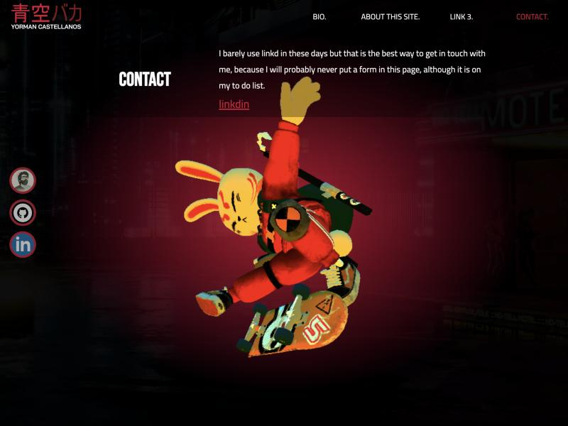
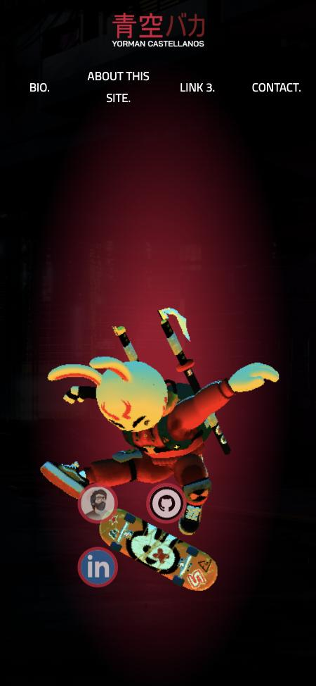
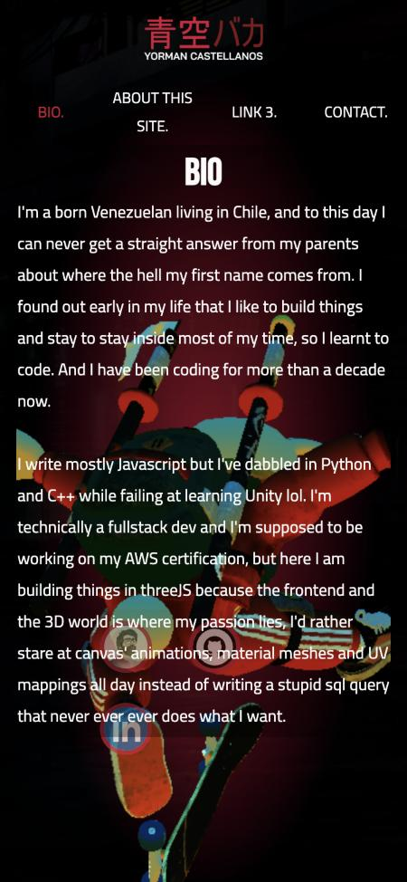

# Reporte As-is: yormancastellanos.com

Fecha: 16 de octubre de 2026. Revisión del sitio en producción (v1, rama `master` / `gh-pages`) en navegador, en escritorio (1024×768) y móvil (375×812). Las capturas están en [`as-is/`](as-is/).

## Resumen

SPA de una sola pantalla: un modelo 3D (conejo ninja skater) flota en el centro sobre una foto de una calle nocturna con luz roja. Una barra superior abre cuatro secciones de texto que aparecen sobre la escena mientras la cámara gira alrededor del modelo. La idea base (modelo como protagonista, sin scroll, texto superpuesto) ya está y es la que se mantiene en v3. Lo que falla es la ejecución del texto superpuesto, el contenido y el móvil.

## Estructura

| Zona | Contenido |
| --- | --- |
| Arriba a la izquierda | Logo `青空バカ` en rojo + "YORMAN CASTELLANOS" |
| Arriba a la derecha | Navegación: `BIO.` · `ABOUT THIS SITE.` · `LINK 3.` · `CONTACT.` |
| Centro | Canvas WebGL con el modelo animado |
| Izquierda, centrado vertical | Tres botones circulares: foto de perfil (enlaza al repo `three-d`), GitHub, LinkedIn |
| Fondo | Foto `bg.jpg` de una calle con un letrero "MOTEL", viñeta oscura y halo rojo detrás del modelo |

No hay footer, ni scroll en escritorio, ni rutas: todo pasa en `/`.

## Interacción

- Al pulsar una sección, el ítem del menú se pone rojo, la cámara cambia de ángulo (Tween.js) y aparece el texto: título en Bebas Neue a la izquierda y párrafo en Cairo a la derecha.
- El texto se dibuja directamente sobre la escena, con una franja oscura muy sutil detrás. No hay panel, borde ni botón de cerrar; no hay forma evidente de volver al estado inicial.
- El modelo no se puede manipular con el ratón; la única interacción 3D son los cambios de cámara por sección.

| Bio | About this site |
| --- | --- |
|  |  |

| Link 3 | Contact |
| --- | --- |
|  |  |

## Contenido

| Sección | Qué dice | Observación |
| --- | --- | --- |
| Bio | Origen (Venezuela → Chile), más de 10 años programando, JS/Python/C++, fullstack con pasión por el frontend 3D | Tono informal y simpático, pero no dice qué rol busca ni qué ha hecho |
| About this site | Three.js + Vue + Tween.js, modelo de Sketchfab, GLB recortado desde 70 MB | Cuenta el proceso; menciona que el modelo es provisional |
| Link 3 | "I have no idea what to put here" | Placeholder en producción |
| Contact | Usa poco LinkedIn pero es la vía de contacto; enlace "linkdin" | Errata en el enlace; sin email ni formulario |

No hay proyectos, experiencia, stack visual ni CV. Erratas visibles: "stay to stay", "myseld", "seen" (por *seeing*), "linkd in", "linkdin".

## Lenguaje visual

- **Paleta:** negro, rojo carmesí (halo, logo, ítem activo, bordes de iconos) y blanco para texto. El modelo aporta amarillo, cian y naranja saturados que compiten con el rojo.
- **Tipografía:** Bebas Neue (títulos), Cairo 300/400 (cuerpo y menú).
- **Estética:** cyberpunk / Tokio nocturno, reforzada por el logo en japonés y el letrero de neón del fondo.
- **Profundidad:** la foto de fondo es plana; no hay paralaje ni relación de luz con el modelo.

## Móvil

| Inicio | Bio |
| --- | --- |
|  |  |

- El menú se parte en dos líneas ("ABOUT THIS / SITE.").
- Los iconos sociales quedan encima del modelo.
- El texto de Bio ocupa toda la pantalla sin fondo y se lee encima del modelo; la página pasa a medir 891 px en un viewport de 812, así que aparece scroll, contra la premisa del sitio.

## Técnico

| Recurso | Transferido | Descomprimido |
| --- | --- | --- |
| `bunny.glb` (sin Draco) | 1,7 MB | 1,9 MB |
| `bg.jpg` | 396 KB | 396 KB |
| `chunk-vendors.js` (Vue + Three + Tween) | 184 KB | 685 KB |
| `profile.jpg` | 81 KB | 81 KB |
| Resto (CSS, logo, SVG, fuentes) | ~20 KB | — |

- `load` en ~1,2 s con buena conexión. No hay pantalla de carga: el modelo aparece de golpe.
- Build con Vue CLI (chunks `app.[hash].js`).
- `<html>` sin atributo `lang`; solo meta `charset`, `X-UA-Compatible` y `viewport`. Sin `description` ni Open Graph: un enlace compartido no muestra vista previa.
- Los tres enlaces de iconos no tienen texto ni `aria-label`; un lector de pantalla los anuncia como "link".
- Los títulos de sección son `h2` sin `h1` en la página.
- Contraste: el texto blanco sobre las zonas amarillas y cian del modelo cae bajo WCAG AA en varias posiciones de cámara.

## Qué funciona

1. El modelo como centro absoluto de atención y la cámara que se mueve por sección dan sensación de "lugar", no de página.
2. Sin scroll en escritorio: todo está a un clic.
3. Personalidad clara: el tono del texto y la estética tienen voz propia.
4. Peso razonable para un sitio 3D.

## Qué no funciona

1. **Texto sin contenedor.** Compite con el modelo y es difícil de leer; justo lo que los popups semitransparentes deben resolver.
2. **Sin estado de salida.** Una sección abierta no se puede cerrar.
3. **Contenido de portafolio ausente.** No hay trabajos, experiencia ni forma clara de contactar; hay un placeholder publicado.
4. **Móvil roto:** menú partido, iconos sobre el modelo, scroll.
5. **Fondo y modelo desconectados:** foto plana con iluminación distinta a la del modelo; paletas que chocan.
6. **Sin carga, SEO ni accesibilidad básica.**

## Preguntas para definir la v3

- **Secciones:** ¿cuáles reemplazan a Bio / About / Link 3 / Contact? (p. ej. Sobre mí, Proyectos, Experiencia, Contacto)
- **Popups:** ¿uno a la vez o varios a la vez? ¿anclados a un lado, flotando cerca del modelo o como tarjetas en las esquinas?
- **Modelo:** ¿solo cambios de cámara por sección o también animaciones del modelo y/o rotación libre con el ratón?
- **Fondo:** ¿escena 3D propia, color/gradiente o imagen?
- **Dirección visual:** ¿conservar algo de la identidad actual (rojo, logo japonés, tono nocturno) o empezar de cero alrededor del nuevo modelo?
- **Idioma:** ¿inglés, español o ambos?

## Decisiones para la v3

Respuestas del 16 de octubre de 2026:

| Tema | Decisión |
| --- | --- |
| Secciones | **Bio**, Projects, Experience, Contact (se mantiene la palabra "Bio") |
| Idioma | Todo el sitio en inglés |
| Popups | Tarjeta flotante semitransparente, una a la vez, junto al modelo y cerca de la parte que enfoca la cámara |
| Modelo | Cada sección cambia el ángulo de cámara y dispara una animación propia del modelo |
| Fondo | Escena 3D propia en Three.js que comparte iluminación con el modelo |
| Identidad | Empezar de cero: nada de la v1 (logo, rojo, tono nocturno); la identidad sale del nuevo modelo |
